[English](README.en.md) | [中文](README.md)

<div align="center">

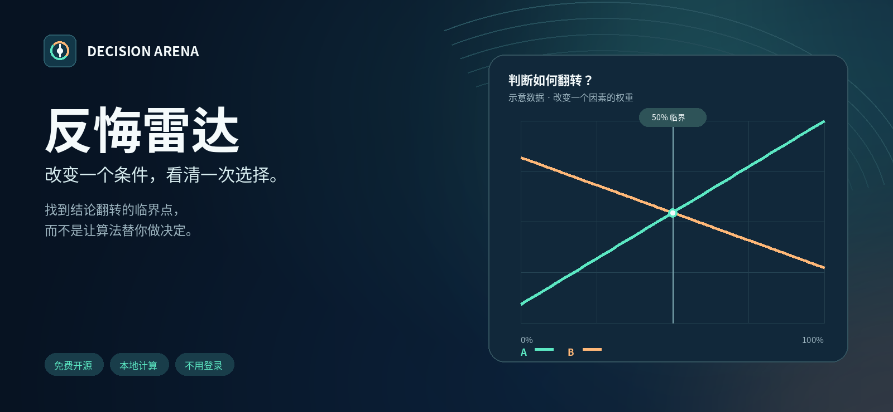

# Decision Arena

### What you're really torn about might just be **one condition**.

Put the two options you keep circling side by side, find the
**tipping point** where the answer flips — then go check the thing that really matters.

## [**▶ Try it in your browser**](https://tbj0623.github.io/decision-arena-lab/)

No sign-up · Nothing uploaded · Completely free · Works the moment you open it

`Vanilla static site` · `The math is fully open` · `Zero third-party dependencies` · `MIT License`

> **A note on language:** the app's interface is **Chinese only** (`lang="zh-CN"`, no i18n layer).
> This English README is documentation, **not** an interface translation — nothing here is "done
> internationalization", and the site does not claim to be bilingual.

</div>

---

<!--
  These are **real browser screenshots** (captured with Playwright Chromium from the
  actual running page at 2× DPR). Not mockups, not AI-generated images. The commit SHA and
  viewport for each shot are recorded in docs/screenshots/manifest.json.
  Every option name and score in the screenshots is fictional sample data.
-->
### The hero: one line of positioning on the left, a demo you can **actually drag** on the right

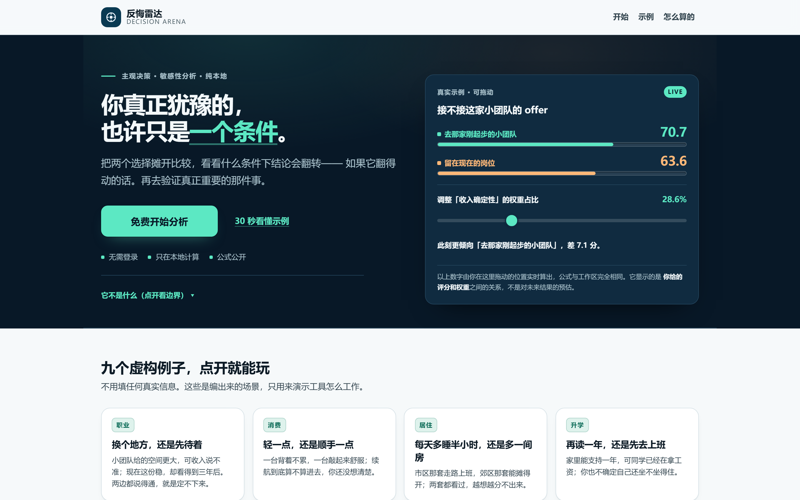

That card on the right is not an illustration. It reads the **same** `EXAMPLES` data as the
workspace below and runs the **same** `core.mjs`. For this example the exact crossing sits at a
weight share of **39.3939%** (weight `6.5`, i.e. `6.5 / 16.5`): set the weight to `6.5` and both
sides read `66.0606`, with a gap of exactly `0`.

Dragging a slider almost never lands on the algebraic solution. Park it near 39.39% and both sides
**display** `66.1` while the raw values still differ by about `2.6e-3` (`2.6e-5` only at the exact 39.3939% point) — the UI then says
"displayed as the same score (rounded to 1 decimal); the raw calculation still differs slightly"
and never calls it an exact tie:

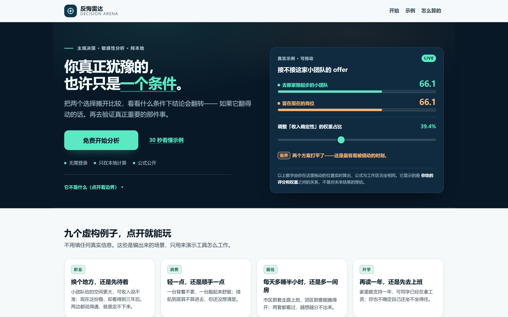

<details>
<summary>Dark theme / mobile / results screenshots</summary>

**Dark theme** (the hero is always deep navy; the rest of the page follows your system theme):

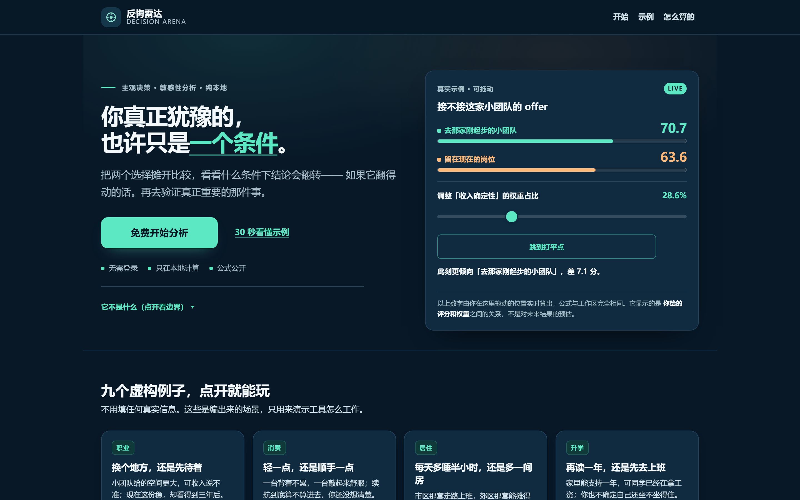

**Mobile at 390px** (the call to action sits on the hero, the draggable demo comes after it, and neither ever covers a button):

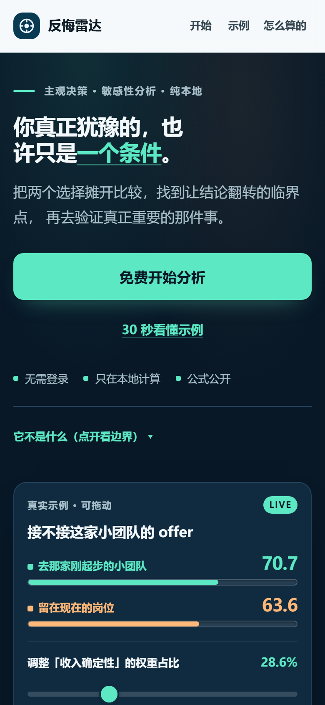

**Results and flip conditions**:

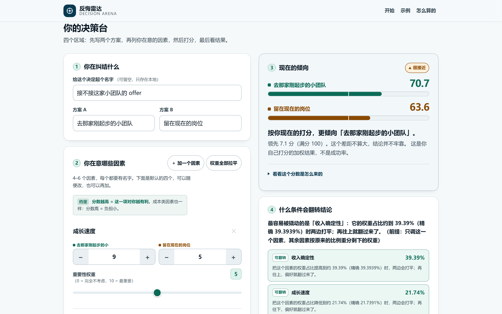

**New: compare a saved baseline against your current edits** (real Chromium screenshot with one fictional score modified):

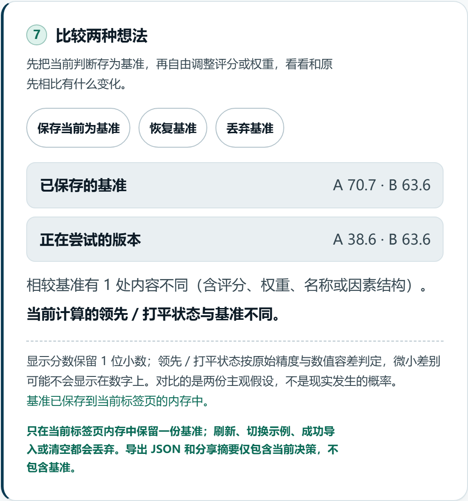

**New: one-rating ±1 stress test** (real Chromium screenshot using the fictional offer example, with rating A for “growth speed” adjusted to 7 to reach a tie):

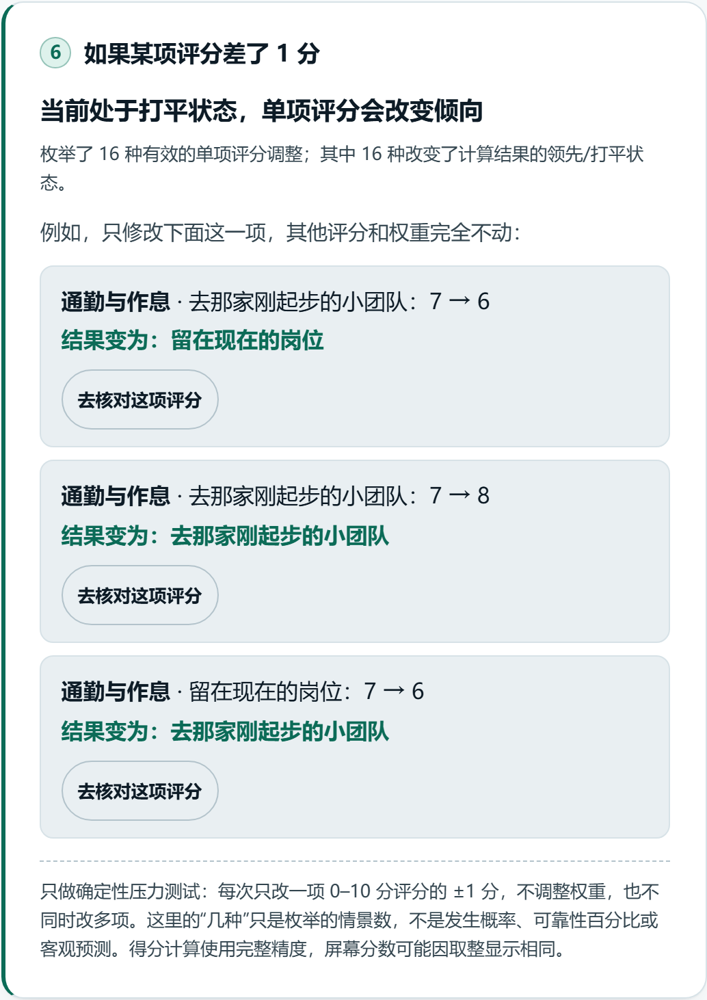

**Nine fictional examples** (career, purchases, housing, education, letting go, relationships, everyday life):

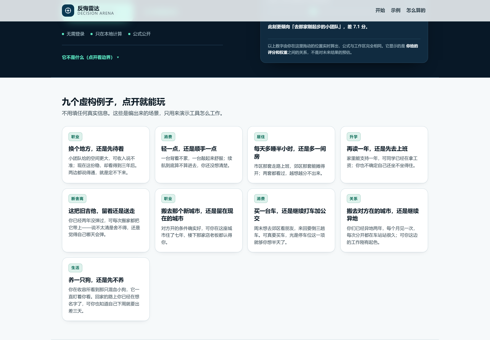

</details>

---

## The problem it solves

You're weighing something up: whether to take the offer, which laptop to buy, rent in the city or
further out, whether to study for one more year, whether to keep the old guitar.

You can list the pros and cons — and still not know which way to go. What usually stops you
isn't a shortage of information. It's that "what do I actually care about most" was never laid
out where you can look at it.

Decision Arena does one narrow thing:

> You turn your own judgment into scores, and then you see exactly **which judgment would
> have to change for the answer to flip**.

It makes **no recommendation** and computes **no success rate**. It answers one question, and it's
the one that's more worth asking.

## Core experiences

| 🧩 Lay it out side by side | 🎯 Find the tipping point | 🔍 Check it first |
|---|---|---|
| Score two options across 4–6 factors, set the weights, and watch the weighted result and each factor's contribution update live | See how far one factor's share of the weight has to move before the two sides tie, or even reverse; when it can't happen, it says so plainly instead of inventing a number | Start from the subjective assumption that moves the result most, and leave with one small check you can finish within a week |

**New: one-rating stress test.** The tool now checks whether changing just **one** subjective rating by **+1 or −1 point** could change the lead, without changing weights or any other ratings. This is a bounded what-if calculation, **not a probability or forecast**.


## V4.0 · Fixed-total weight reallocation

Step 8 now offers an optional **Keep the raw weight total fixed** mode. V3's independent raw-weight changes remain the default. In the new mode, uncertain weights can move **only by compensating each other**, while unselected weights stay unchanged and the overall raw-weight total equals the current baseline. Selecting just one uncertain weight therefore gives it no freedom to change.

The engine enumerates feasible bounded-simplex vertices (at most 6×2⁵=192 candidates for six factors) to compute exact A−B extremes jointly with selected uncertain score intervals. The actual feasible boundary scenario can be applied with confirmation and undone. Changing modes does not persist or export any uncertainty settings. These remain deterministic assumptions, never probabilities. See [the mathematical derivation](docs/UNCERTAINTY_METHOD.md).

## V3.0 · Combined rating and weight uncertainty

Step 8 now accepts **both uncertain scores and uncertain raw weights**. Select individual score cells (±0.5, ±1, ±2 points) and/or factor weights (a separate ±0.5, ±1, ±2 original weight units). Unselected inputs remain fixed. The engine computes **exact joint bounds** for A−B while *renormalizing the changed weights*. Inspect a feasible extreme scoring/weighting scenario, optionally apply it with confirmation, then Undo to restore the original values.

A zero-sum weight configuration has no valid weighted average and is excluded. With no uncertain weights, all V2.0 behavior remains unchanged. These are **assumption-bounded deterministic results**, never probabilities or forecasts, and depend on independent-range assumptions.

**Real Chromium screenshot:** four A ratings and four raw weights each vary by up to ±2 units, yielding a joint A−B interval of −30.00 to +36.43 in this fictional example.

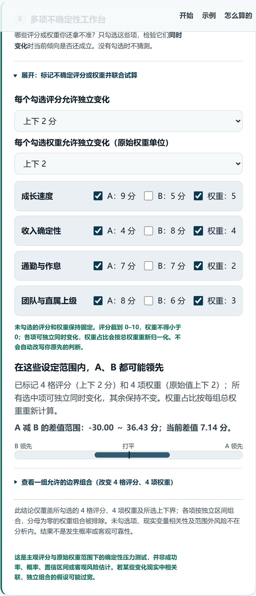 See [the derivation](docs/UNCERTAINTY_METHOD.md).

## V2.0 · Joint uncertainty workbench

Step 8 adds an optional, collapsible deterministic interval analysis. **Select only the individual ratings you are genuinely unsure about**, then allow each of those ratings to vary by up to **±0.5, ±1, or ±2 points** (clipped to 0–10). Unselected ratings stay fixed; **if no weight is selected**, all weights stay fixed (V2 behavior). The engine calculates the **exact minimum and maximum A−B score difference** across all independent combinations of these ranges. You can inspect a concrete boundary scenario and apply it to your current scores with confirmation and Undo support.

These ranges reflect subjective assumptions, not measured error distributions. **The result is not a probability, confidence level, or forecast**; potential correlations or uncertainty in the weights are outside this model. No selections means no robustness claim. See the [method and limitations](docs/UNCERTAINTY_METHOD.md).

Real Chromium screenshot with a fictional career-offer example (four A scores allowed to vary independently by ±2 points):

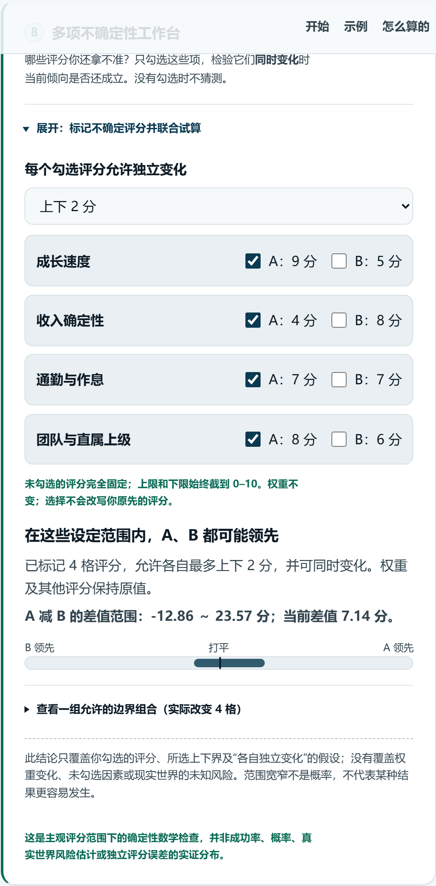

## Undo and redo: experiment safely

The toolbar has **Undo** and **Redo** buttons. You can undo confirmed rating/weight edits, factor changes, equal weights, the tipping-point jump, and baseline restoration. The current tab keeps up to **30 steps**; rapid changes to the same slider or input are grouped. A new edit after undo discards the old redo path.

**Privacy boundary:** reload, reset, switching examples, and a successful JSON import permanently clear the in-memory edit history. It is not autosave or a backup; export JSON yourself to keep a decision across sessions. The actual UI remains Chinese-only.

## Compare against a saved baseline

After scoring a decision, click **Save current as baseline** in Step 7. Edit any rating, weight, factor or label to compare the current A/B scores against your snapshot. Restoring the baseline requires confirmation and overwrites unexported edits.

Only **one in-memory baseline** is stored in the current tab; it disappears on refresh, reset, a different example or a successful JSON import. Export and sharing contain the current decision **only**. These are comparisons between subjective assumptions, not probability or measured real-world reliability. The actual UI remains Chinese-only.

## How to use it

1. Open the [online tool](https://tbj0623.github.io/decision-arena-lab/). Load a **fictional example**, or type in your own two options.
2. List the **4–6 factors** you care about, rate A and B from **0 to 10**, then set a **non-negative weight** for each (you can set 0, meaning "setting this aside for now").
3. Read the two 0–100 scores, the gap between them, and the **per-factor breakdown**.
4. Read the "what would flip this" panel — how far a factor's weight share has to go before the two sides tie, and **which assumption is worth checking first**.
5. Check whether a **single rating ±1 point** would change the result; the number of tested cases is not a probability.
6. Undo/redo up to 30 edit steps within the current tab.
7. Optionally use Step 8 to stress-test several uncertain ratings and weights simultaneously.
8. **Export to JSON** if you want to keep it. Refresh and it's gone; no record is kept.

> **What it is not, in one sentence**: the scores come from ratings and weights **you** typed in. They are a weighted average — **not a success rate, not a forecast, not a measurement**. For high-stakes medical, legal, or financial decisions, talk to a qualified professional; this tool can only help you get the pieces straight.

## The tipping point in one picture

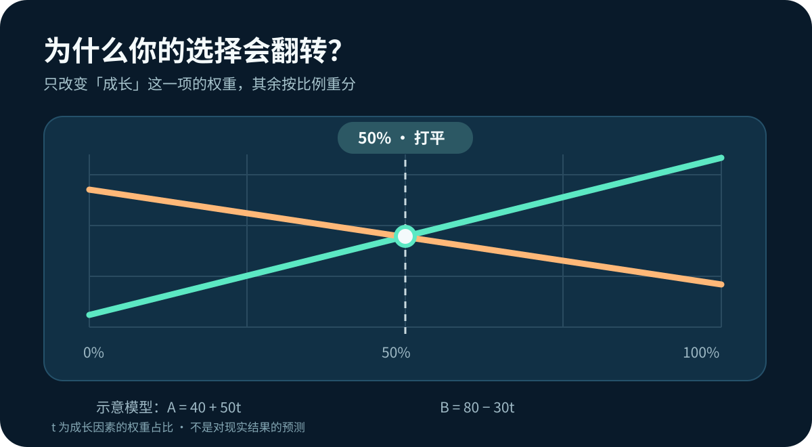

*Illustrative numbers: suppose the two options' scores vary with a factor's weight share `t` as `A = 40 + 50t` and `B = 80 − 30t`. They tie at `t = 50%`. Here `t` is a **weight share** — not a probability, and not a prediction about the world.*

## How the math works

No black box. The entire math is these few lines.

Let options A / B carry ratings `rA[i]`, `rB[i]` on factor `i` (each 0–10), with weight `w[i] ≥ 0`:

```
Normalized weight   p[i] = w[i] / Σw
Option score        S(A) = 10 × Σ ( p[i] × rA[i] )      // range 0–100
Gap                 Δ    = S(A) − S(B)
Flip point          Hold one factor's share at t and redistribute
                    the remaining (1−t) in the others' original
                    proportions; solve Δ(t) = 0 for the share t*
```

- **`t*` falls outside 0–1** → it tells you plainly that moving this one factor alone cannot flip the result. **It does not make up a number.**
- **`|Δ| < 1e-9`** → an **exact tie** (`TIE_EPSILON = 1e-9`). Read that as "equal within a numerical
  tolerance", **not** as infinite-precision equality. This is the only level at which the app is
  allowed to say the scores are *exactly* the same.
- **Same score after rounding to 1 decimal, but `|Δ|` above 1e-9** → a **display tie**. The app then
  says "displayed as the same score (rounded), the raw calculation still differs slightly" and never
  claims an exact tie.
- **Screen rule:** the screen says "tie" ⇔ the two numbers on screen are identical. The gap line is
  computed by subtracting the two **displayed** numbers (`66.1 − 66.0 = 0.1`), so you never see two
  identical scores alongside "A leads by 0.0".

The implementation lives in [`site/core.mjs`](site/core.mjs) (scoring and thresholds) and
[`site/precision.mjs`](site/precision.mjs) (`fmt1` and the three-level tie test): **dependency-free
pure functions**, usable from both Node and the browser, covered by unit tests. More on the edge
cases in [Limitations](docs/LIMITATIONS.md).

## Quick start

You need Node.js 18+. **There are no third-party npm packages at runtime.**

```bash
git clone https://github.com/tbj0623/decision-arena-lab.git
cd decision-arena-lab

node scripts/serve.mjs             # local preview → http://127.0.0.1:8080
node --test                        # run the whole test suite
node scripts/check-no-network.mjs  # verify "zero external requests / zero persistence"
```

> **⚠️ Double-clicking `site/index.html` will not work.** The site uses native ES Modules, and the browser's CORS policy blocks them under `file://`, leaving a blank page. That's a browser security rule, not a defect in this project, and it won't be worked around with a bundler — use the static server above.

> **About the test command**: run `node --test` with **no arguments**. On Node 24, `node --test tests/` treats the directory as a module and fails with `MODULE_NOT_FOUND`; `node --test "tests/**/*.test.mjs"` is the alternative.

## Technical details

| Item | Detail |
|---|---|
| Shape | Static front end only — **no build step**, no backend, no database |
| Dependencies | **Zero runtime dependencies** (no CDN, no external fonts, no analytics SDK) |
| Storage | **No** `localStorage` / `sessionStorage` / cookies / IndexedDB |
| Network | **Zero external requests** at runtime, checked automatically by `scripts/check-no-network.mjs`. There is **no Service Worker**, so this is **not** an offline PWA and cannot be "installed and opened offline"; the accurate phrasing is "local computation / static site / runs behind a local server" |
| Computation | [`site/core.mjs`](site/core.mjs) (scoring and thresholds) + [`site/precision.mjs`](site/precision.mjs) (display precision, tie levels) — dependency-free pure functions, with input validation and stable error codes |
| Tests | `node --test` (no arguments). Covers the math's edge cases, the UI contract, the accessibility contract, and the zero-network and security audits. **The docs deliberately don't hard-code a test count** — it changes daily, so any number here would go stale; go by the `node --test` output, and open an issue if anything fails |
| Deployment | GitHub Pages (`.github/workflows/pages.yml`) |
| Export | Generates a JSON file locally in your browser, never through a server |

### Repository layout

```
site/            The app itself (index.html / app.mjs / core.mjs / features / styles)
docs/            Documentation (product spec, acceptance checklist, privacy, limitations, changelog, assets)
tests/           Tests (core math, UI contracts, QA scenarios)
scripts/         serve / check-no-network / make-release
.github/         Pages workflow, issue templates
```

## Contributing

Feedback is welcome on **broken features, copy that doesn't land, mobile experience, and accessibility**.

- [Report a problem or suggest something](https://github.com/tbj0623/decision-arena-lab/issues)
- The process is described in [CONTRIBUTING.md](CONTRIBUTING.md)

> ⚠️ **Please don't paste real work, health, financial, or personal decisions into a public issue.** A made-up example is enough to explain the problem.

## Privacy

- Everything you type **exists only in the current page** and disappears on refresh.
- No accounts, no server, no analytics, no third-party scripts.
- Exports and share summaries are generated locally by your browser.
- The one exception is our host, GitHub Pages, which may keep basic access logs (IP, user agent). That is unrelated to this tool; see [Privacy](docs/PRIVACY.md).

## Limitations and disclaimer

- **It does not predict the future.** The output is nothing more than your own subjective ratings, weighted by weights you set yourself.
- **It doesn't know what you're unsure about.** If a rating is a guess, the tool can't tell — it can only nudge you to verify it.
- **It isn't built for high-stakes fields.** For medical, legal, financial, or crisis situations, go to a qualified professional.
- **It comes with no guarantee of any kind.** The decision, and the consequences, are yours.

The full statement is in [Limitations](docs/LIMITATIONS.md); version history is in the [CHANGELOG](docs/CHANGELOG.md).

## Delivery and maintenance

- [V9 final delivery report](docs/release/V9_FINAL_DELIVERY.md) — every requirement checked off, a **defect ledger (48 unique defects, each with an ID, evidence and commit SHA)**, live measurements, and an honest list of what was *not* done
- [Rollback plan](docs/release/ROLLBACK_V9.md) — one `git revert` path (force-push is forbidden); the network-blocked-era API procedure is kept only as a dated historical appendix

## License

[MIT License](LICENSE). Open source, with **no guarantee whatsoever about how real-world decisions turn out**.

<div align="center">

**[⬆ Back to top](#decision-arena)** · **[▶ Try it now](https://tbj0623.github.io/decision-arena-lab/)**

</div>
