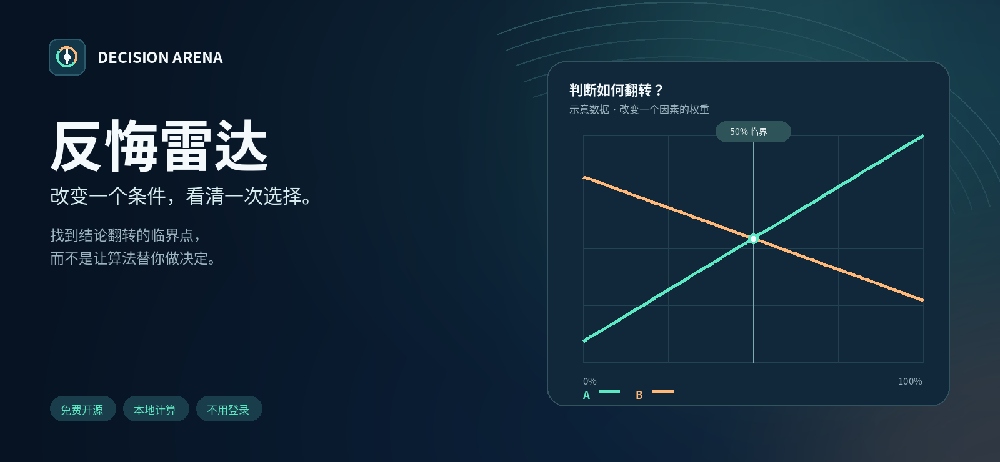
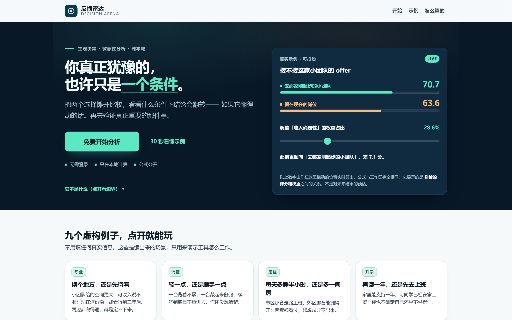
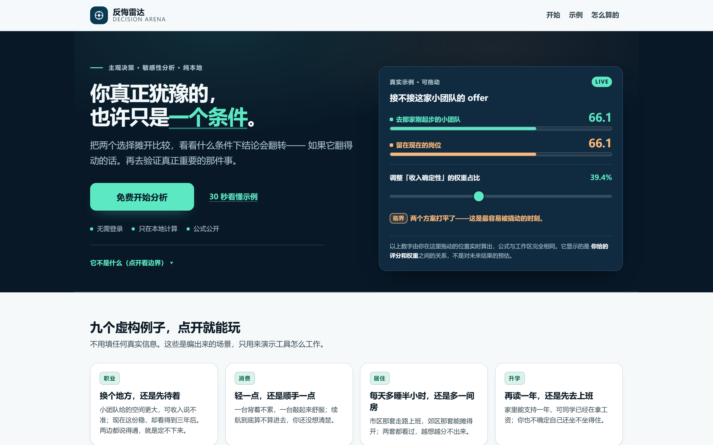
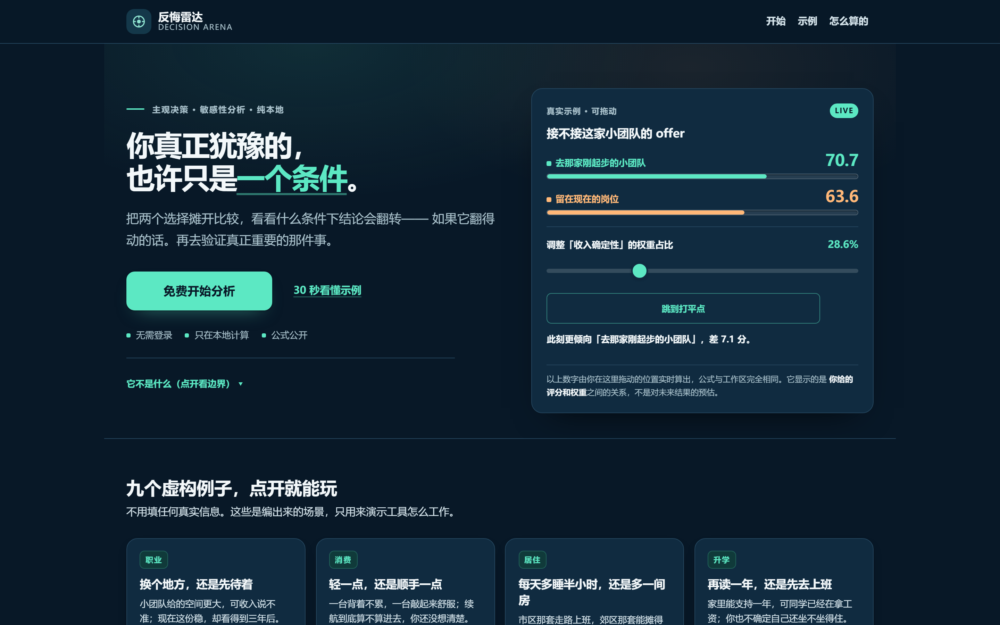
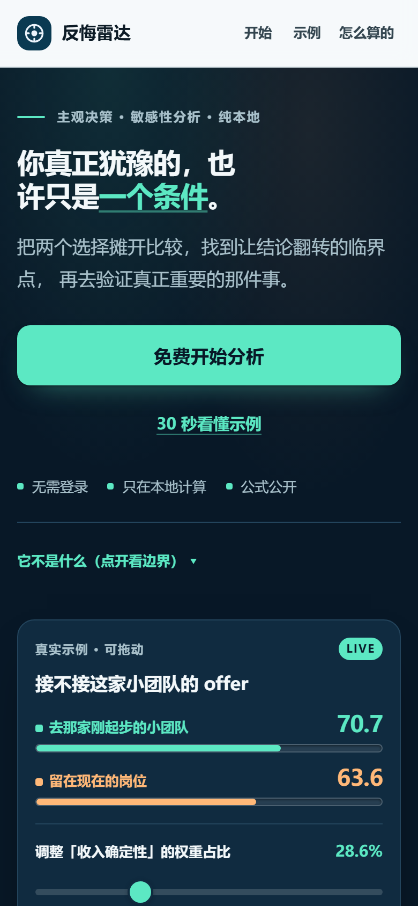
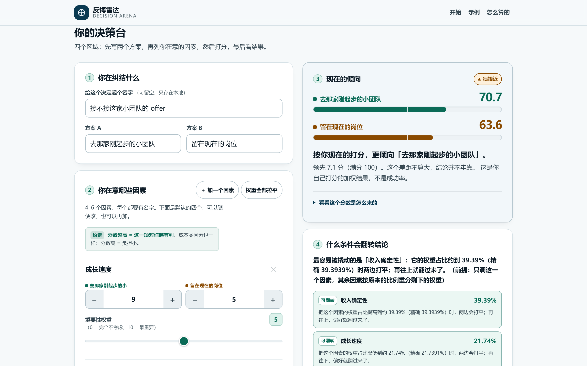
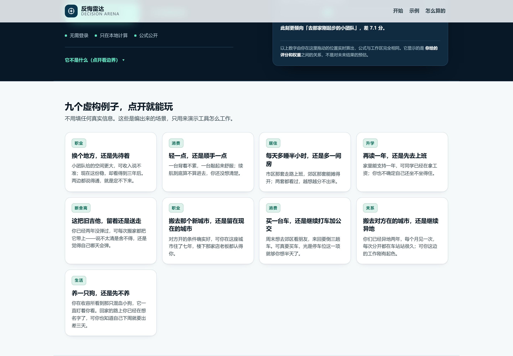
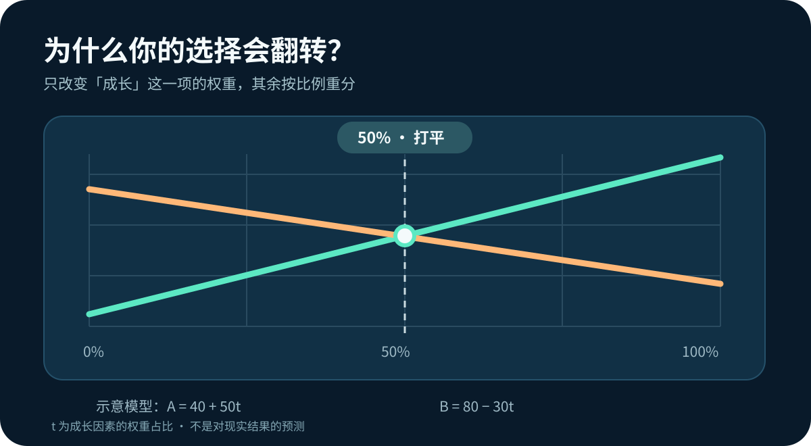

[中文](README.md) | [English](README.en.md)

<div align="center">



# 反悔雷达 · Decision Arena

### 你真正犹豫的，也许只是**一个条件**。

把两个让你纠结的选择摊开比较，找到让结论翻转的**临界点**，
再去验证真正重要的那件事。

## [**▶ 立即在线试用**](https://tbj0623.github.io/decision-arena-lab/)

不用注册 · 不上传数据 · 完全免费 · 打开即用

`纯前端静态站` · `数学过程完全公开` · `零第三方依赖` · `MIT License`

</div>

---

<!--
  下面是**真实浏览器截图**（Playwright Chromium 从真实运行页面截取，2× DPR）。
  不是设计原型、不是 AI 生成图。每张的 commit SHA 与视口记录在
  docs/screenshots/manifest.json 里。
  截图里的方案名与评分全部是虚构示例数据。
-->
### 首屏：左边一句定位，右边一个**真的能拖**的示例



右侧那张卡不是插图——它读的是和下面工作区**同一份** `EXAMPLES` 数据，
跑的是**同一个** `core.mjs`。把滑杆拖到约 39.39%（精确 39.3939%），两个分数会真的打平：



<details>
<summary>深色主题 / 手机端 / 结果区 截图</summary>

**深色主题**（首屏固定深海军蓝，正文区跟随系统主题）：



**手机端 390px**（CTA 在上，演示卡在下，不挡按钮）：



**结果区与翻转条件**：



**九个虚构示例**（覆盖职业 / 消费 / 居住 / 升学 / 断舍离 / 关系 / 生活）：



</details>

---

## 它解决什么问题

你正在犹豫：接不接这个 offer、买哪台电脑、租市区还是郊区、要不要再读一年、旧吉他还留着吗。

你列得出利弊，但**列完还是不知道该选哪个**——因为真正卡住你的不是信息不够，而是"我到底更在意什么"这件事没被摊开。

反悔雷达做一件很窄的事：

> 你把主观判断变成可计算的分数，然后看清楚**"哪个判断一变，结论就翻"**。

它**不给推荐**，也**不算成功率**。它只回答一个更值得追问的问题。

## 三个核心体验

| 🧩 摊开比较 | 🎯 找到临界点 | 🔍 先去验证 |
|---|---|---|
| 给两个方案、4–6 个因素打分并设权重，实时看到加权结果与逐项贡献 | 看哪个因素的权重占比一变，两边就打平甚至反转；不可行时如实说"翻不过来" | 从影响最大的那条主观假设出发，得到一个 7 天内能完成的小验证动作 |


## 怎么用

1. 打开[在线工具](https://tbj0623.github.io/decision-arena-lab/)。可以先点一个**虚构示例**，或直接写你自己的两个方案。
2. 列出 **4–6 个**你在意的因素，给 A、B 各打 **0–10** 分，再设定**非负权重**（可以设 0，表示"这条暂时不考虑"）。
3. 看两边的 0–100 分、差值、以及**逐因素贡献拆解**。
4. 看「什么条件会翻转结论」——哪个因素的权重占比到多少时打平，以及**最该先去核实哪条假设**。
5. 想留存就**导出 JSON**；刷新即清空，不留任何记录。

> **一句话说清它不是什么**：分数来自**你自己**填的评分和权重，是加权平均的结果，**不是成功率、不是预测、不是科学测量**。医疗、法律、财务这类高风险决定，请咨询有资质的专业人士——本工具只能帮你把要素列清楚。

## 一张图理解「反转阈值」



*示意数据：假设两个方案的评分随某因素权重占比 `t` 变化分别为 `A = 40 + 50t` 与 `B = 80 − 30t`，则 `t = 50%` 时两边打平。这里的 `t` 是**权重占比**，不是概率，也不是对现实的预测。*

## 怎么算的

没有黑箱。全部数学就这几行：

设方案 A / B 在第 `i` 个因素上的评分为 `rA[i]`、`rB[i]`（各 0–10），权重为 `w[i] ≥ 0`：

```
归一化权重   p[i] = w[i] / Σw
方案得分     S(A) = 10 × Σ ( p[i] × rA[i] )        // 范围 0–100
方案差值     Δ    = S(A) − S(B)
反转阈值     固定某因素占比为 t，其余按原比例重分 (1−t)
             解 Δ(t) = 0 得临界占比 t*
```

- **`t*` 落在 0–1 之外** → 如实告诉你"只调这一个因素翻不过来"，**不编一个数字**。
- **`|Δ| < 1e-9`** → 判为「打平」，不判胜负。
- 差值始终用**未取整的原始值**相减，避免显示误差。

实现集中在 [`site/core.mjs`](site/core.mjs)，是**零依赖纯函数**，可在 Node 与浏览器通用，并配有单元测试。更多边界说明见 [局限说明](docs/LIMITATIONS.md)。

## 快速开始

需要 Node.js 18+。**运行时无任何 npm 第三方依赖。**

```bash
git clone https://github.com/tbj0623/decision-arena-lab.git
cd decision-arena-lab

node scripts/serve.mjs             # 本地预览 → http://127.0.0.1:8080
node --test                        # 跑全部测试
node scripts/check-no-network.mjs  # 核验"零外部请求 / 零持久化"
```

> **⚠️ 直接双击 `site/index.html` 打不开。** 本站用原生 ES Module，浏览器在 `file://` 下的 CORS 策略会拒绝加载，页面空白。这是浏览器安全限制，不是本站缺陷，也不会为此加打包步骤——用上面的静态服务器即可。

> **测试命令**：请用**无参数**的 `node --test`。Node 24 下 `node --test tests/` 会把目录当模块解析并报 `MODULE_NOT_FOUND`；同理可用 `node --test "tests/**/*.test.mjs"`。

## 技术细节

| 项 | 说明 |
|---|---|
| 形态 | 纯前端静态站，**无构建步骤**、无后端、无数据库 |
| 依赖 | **零运行时依赖**（无 CDN、无字体外链、无分析 SDK） |
| 存储 | **不使用** `localStorage` / `sessionStorage` / Cookie / IndexedDB |
| 网络 | 运行时**零外部请求**，可由 `scripts/check-no-network.mjs` 自动核验 |
| 计算 | [`site/core.mjs`](site/core.mjs) — 零依赖纯函数，含输入校验与稳定错误码 |
| 测试 | `node --test`（无参数）。测试套件约 **211 项**，覆盖数学边界、UI 契约、零网络与安全审计。**具体通过数以你本地运行为准**——本项目仍在迭代，不在文档里写死数字；若出现失败，请以 `node --test` 输出为准并提 Issue |
| 部署 | GitHub Pages（`.github/workflows/pages.yml`） |
| 导出 | 生成 JSON 文件，浏览器本地完成，不经任何服务器 |

### 目录结构

```
site/            应用本体（index.html / app.mjs / core.mjs / features / styles）
docs/            文档（产品需求、验收清单、隐私、局限、变更说明、素材）
tests/           测试（core 数学、UI 契约、QA 场景）
scripts/         serve / check-no-network / make-release
.github/         Pages 工作流、Issue 模板
```

## 为它做贡献

欢迎反馈**功能问题、文案看不懂的地方、移动端体验、无障碍问题**。

- [报告问题或提建议](https://github.com/tbj0623/decision-arena-lab/issues)
- 贡献流程见 [CONTRIBUTING.md](CONTRIBUTING.md)

> ⚠️ **请勿在公开 Issue 里贴真实的工作、健康、财务或私人决策内容。** 用虚构示例就能说清楚问题。

## 隐私

- 你输入的一切**只在当前页面内存在**，刷新即消失。
- 没有账号、没有服务器、没有埋点、没有第三方脚本。
- 导出与分享都由浏览器本地生成。
- 唯一例外是托管方 GitHub Pages 可能记录基础访问日志（IP、UA 等），这与本工具本身无关，详见 [隐私说明](docs/PRIVACY.md)。

## 局限与免责

- **它不预测未来。** 输出只是你自己的主观评分在你自己设定的权重下的加权结果。
- **它不知道你不确定什么。** 若你给的分本身是猜的，工具无法识别，只能提醒你去核实。
- **它不适合高风险领域。** 医疗、法律、财务、危机处置等请找有资质的专业人士。
- **它不构成任何保证。** 决定权和后果都在你自己手上。

完整说明见 [局限说明](docs/LIMITATIONS.md)；版本变更见 [CHANGELOG](docs/CHANGELOG.md)。

## 交付与维护

- [V9 最终交付报告](docs/release/V9_FINAL_DELIVERY.md) — 全部要求逐条对照、修掉的 32 个缺陷、线上实测数据、未完成项清单
- [回滚方案](docs/release/ROLLBACK_V9.md) — 三条可执行的回滚路径

## 许可

[MIT License](LICENSE)。开源，但**不对现实决定的结果作任何保证**。

<div align="center">

**[⬆ 回到顶部](#反悔雷达--decision-arena)** · **[▶ 立即试用](https://tbj0623.github.io/decision-arena-lab/)**

</div>
